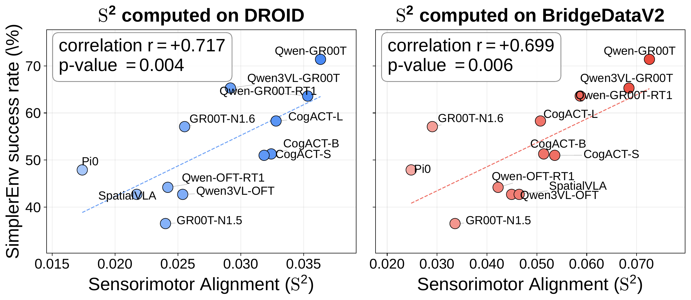
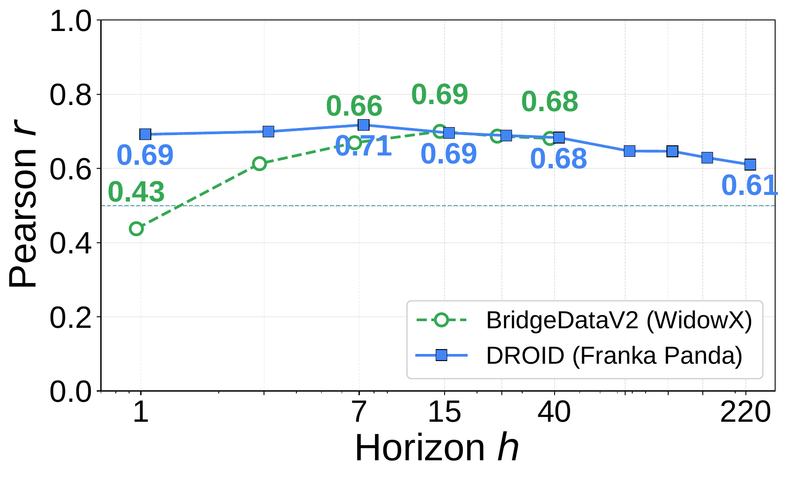

<!--
Conventions build.py relies on:
- The first paragraph after the H1 becomes the subtitle (dek).
- An image paragraph followed by an italic paragraph becomes a numbered figure with that caption; Figure 1 is pulled out as the opening figure.
- Footnotes ([^key]) become margin sidenotes. Write each definition as: [Title](link) (Author et al, Year).
- <details class="technical-note"> blocks are collapsible asides.
- A table followed by an italic paragraph gets that paragraph as its caption.
- H2 and H3 headings appear in the contents list on the left.
-->

# Title

*Subtitle.*


*Left: a robot reaching for a mug gives us two views of one physical interaction, a sensory observation and an executed motion. Sensorimotor Alignment, S², measures whether similar observations in a model's representation correspond to similar demonstrated motions. Right: each point is one VLA. Higher alignment accompanies higher task success in SimplerEnv, a robot simulation benchmark. The correlation across these twelve models is 0.717.*

The Platonic Representation Hypothesis (PRH)[^prh] argues that as vision and language models scale, their representation spaces converge toward a shared statistical model of reality. The reason is that images and text are both projections of the same underlying world, so better models of either one should end up organizing that world in similar ways.

In this work, we bring PRH to robotics and ask: can physical actions be viewed as another projection of that world, such that more capable embodied models better align their vision and language representations with the structure of motion trajectories?

Our evidence suggests the answer is yes. To test this, we measure how well an embodied model's representation of a sensory input (what it sees and what it is told) aligns with the motor trajectory that should follow. Put simply, if two situations look alike to the model, they should also call for similar motions. We call this measure sensorimotor alignment (S²).

Our first finding is that S² is positively related to downstream robot task success. We test a range of Vision-Language-Action models (VLAs) and World Action Models (WAMs), both in simulation and on real robots. In every setting, models with higher S² achieve higher success rates. This suggests that PRH also holds in robotics: a more capable embodied model is one whose vision and language representations better reflect the structure of physical motion.

S² also explains, at the representation level, several behaviors that prior work has only observed empirically. For example, VLAs often ignore the language instruction and act mainly on what they see. We find that their success tracks the S² of their vision features, not their text features.

More broadly, S² can serve as a low-cost offline proxy for identifying which models are likely to achieve higher task success before closed-loop evaluation. For instance, it can identify promising VLM backbones even before costly VLA fine-tuning.

## Measuring sensorimotor alignment

Camera features and robot trajectories live in different spaces, so we cannot compare them directly. Following PRH,[^prh] we instead compare their *similarity structures*: does each representation judge the same pairs of episodes to be alike? Each side gives us a kernel $K$, a matrix of pairwise similarities over the same episodes, and S² scores how well the two kernels agree.

We compute S² on a fixed offline dataset $\mathcal{D} = \{e_i\}_{i=1}^N$, such as DROID.[^droid] Each episode $e_i = (\mathbf{x}_i, \boldsymbol{\tau}_i)$ pairs a sensory input $\mathbf{x}_i$, a camera image and a language instruction, with the trajectory $\boldsymbol{\tau}_i$ that a human teleoperator then executed. Every model is scored against the same recorded motions, so no closed-loop rollouts are needed.

The **sensory kernel** comes from the model. We feed $\mathbf{x}_i$ to the model, extract a feature vector $\mathbf{z}_i$, and compare episodes by cosine similarity, $K^{\mathrm{sensory}}_{ij} = \cos(\mathbf{z}_i, \mathbf{z}_j)$. Because this works for any architecture and layer, we can compare vision features, text features, or features taken at different depths.

The **motor kernel** comes from the robot. Each trajectory records the end-effector position, orientation, and gripper state. The same task can be performed faster or slower, so we compare trajectories with dynamic time warping (DTW),[^dtw] which aligns their timing before measuring distance, $K^{\mathrm{motor}}_{ij} = \mathrm{DTW}(\boldsymbol{\tau}_i, \boldsymbol{\tau}_j)$.

To compare the two kernels, we look at neighborhoods. Take one episode as the query and find its $k$ nearest neighbors under each kernel. The illustration below uses $k = 3$; our experiments use $k = 10$. If the model organizes episodes by the motion they require, the two neighbor sets should largely overlap.

<div class="explainer-slot"></div>

S² aggregates this agreement over every query episode. We use Centered Kernel Nearest-Neighbor Alignment (CKNNA) from PRH, which measures how strongly the two kernels co-vary within these shared neighborhoods:

$$\mathrm{S}^2 = \mathrm{CKNNA}\left(K^{\mathrm{sensory}}, K^{\mathrm{motor}}\right)$$

A high S² means the model places episodes close together when they call for similar motions, not merely when they look or sound alike.

<details class="technical-note">
<summary>Implementation details</summary>

For video datasets, the sensory input uses only the first frame of each episode, matching standard VLA inputs. Trajectories are expressed in the robot base frame. The DTW local cost uses geodesic distance on SO(3) for rotations and native coordinates for positions and gripper state.

</details>

## S² Relates to Robot Task Success Rate

Action is a harder test case for PRH[^prh] than vision or language: it is a physical trajectory, not another passive observation. We test the premise directly: a model's S² should positively relate to its downstream robot task success. S² cannot replace closed-loop evaluation, but if this holds, it can cheaply indicate offline which representations support successful control.

Below, we show this relation across three model families and real-robot policies, compare S² with VQA and video-quality metrics, and check that it is robust to evaluation choices.

### S² Relates to Task Success Across Model Families

We ask whether stronger alignment between sensory and motor similarity structures accompanies higher task success. In the figure below, we test this across three model families and on policies evaluated on real robots. For each model, we compute S² from its sensory features on a reference dataset (x-axis) and compare it with the model's downstream manipulation success rate (y-axis).


*S² correlates with task success across diverse model families and both simulated and real-world task evaluations. From left to right, each panel plots offline S² (x-axis) against downstream success (y-axis) for finetuned VLAs, raw VLMs, WAMs, and real-robot policies. These correlations support S² as a paradigm-agnostic metric.*

**Vision-language-action models (VLAs).** We test 12 VLAs against their SimplerEnv[^simplerenv] success rates. The correlation r = +0.717 is strong. This supports our premise that S² captures a control-relevant representation.

**Vision-language models (VLMs).** We ask whether S² computed on a raw VLM, before any robot fine-tuning, relates to the success of the VLA built from it. We compute S² for 8 raw VLM backbones from VLM4VLA[^vlm4vla] on the DROID dataset[^droid] and compare it with the SimplerEnv success of the VLAs that VLM4VLA fine-tunes from them. We find a strong correlation with downstream VLA success: r = +0.681. This demonstrates the practical utility of S²: models with stronger sensorimotor alignment before fine-tuning tend to achieve higher downstream task success, so S² can identify promising VLM backbones even before costly VLA fine-tuning.

**World action models (WAMs).** Finally, we ask whether the relation extends to WAMs, which build on video generators rather than VLMs. We compute S² for 6 WAMs on the bimanual ALOHA dataset[^aloha] and compare it with their success on RoboTwin 2.0[^robotwin]. For WAMs, the sensory representation is the video-generator latent used for action decoding, and all 6 models share the same ALOHA trajectories and S² settings. Across these 6 models, S² shows a strong correlation with success, r = +0.718.

**Real-robot policies.** We test whether the relation in simulation between S² and task success extends to real robots. Because real-world success depends on the task set, robot, cameras, and protocol, we use the physical-robot success rates that MolmoB0T[^molmobot] reports for 5 policies on the same 40 tasks, and compute S² for their public checkpoints on the same 6,000-episode DROID subset. Across these 5 policies, S² shows a strong correlation with real-robot task success, r = +0.831.

<details class="technical-note">
<summary>Details</summary>

- For the 12 VLAs, the model-bootstrap 95% confidence interval of r = +0.717 is [+0.436, +0.912]. We further check that this correlation does not depend on model family, model scale, or VLA training setup (Appendix B.2 of our paper).
- One-tailed p-values are p = 0.031 for the raw VLMs, p = 0.054 for the WAMs, and p = 0.041 for the real-robot policies.
- The six WAMs and their shared evaluation protocol are listed in Appendix A.4 of our paper. Shared evaluation conditions and checkpoint scoring for the real-robot policies are described in Appendix A.4 of our paper as well.
- S² also relates to downstream success for frozen vision backbones under low-data behavior cloning and visual-reward learning (Appendix B.1 of our paper).

</details>

### S² Relates to Task Success More Closely Than Alternative Metrics

Prior work asks whether offline evaluation scores predict downstream control performance. VLM4VLA examines the correlation between VQA benchmark scores and the performance of the resulting VLA policies, finding weak or even negative correlations. For video models, Tian et al.[^tian] compare the quality of WAM-generated video with downstream control performance and find that the agreement is inconsistent across tasks. A common limitation is that these metrics measure language understanding or pixel-level fidelity, neither of which is grounded in the physical actions the robot must execute. S² addresses this gap by directly linking perception to action. As we show below, S² correlates more strongly with task success rate than any VQA or video-quality metric we evaluate.

**S² correlates with VLA success where VQA scores do not.** We compare S² with aggregate VQA scores as offline proxies of downstream VLA success, using the same 8 raw VLM backbones and evaluation setting as in the VLM comparison above. We find that VQA scores show virtually no correlation with VLA success (r = −0.154; figure below, right), whereas S² correlates strongly (r = +0.681; figure below, left). S² thus tracks VLA success where VQA benchmarks do not.


*Raw VLM S² correlates with downstream VLA success. Across 8 models, raw VLM VQA scores (right) show virtually no correlation with finetuned SimplerEnv policy success. S² (left) correlates strongly with policy success, offering a cheap guide to model choice. The left panel repeats the raw-VLM result from the figure above for comparison.*

**S² correlates with WAM success more closely than video-quality metrics.** We compare S² with standard video-quality metrics (FID[^fid], SSIM[^ssim], and PSNR) on 3 of the WAMs, Motus, LingBot-VA, and Vidar, evaluated on RoboTwin. We find that video-quality metrics show no significant correlations with task success: SSIM reaches only r = +0.558 and PSNR only r = +0.468 (figure below). FID even correlates in the wrong direction. Because lower FID indicates higher video quality, a useful FID proxy would correlate negatively with success; instead, we find r = +0.680. In contrast, S² computed on ALOHA episodes correlates far more strongly (r = +0.999) and is the only metric that correctly recovers the success-rate ordering. Pixel-level forecasting fidelity thus shows little relation to the control success that S² captures.


*S² correlates with WAM success where perceptual metrics do not. For 3 WAM policies evaluated on RoboTwin, standard video-quality metrics (SSIM, PSNR, FID) show no significant correlations with task success. In contrast, only S² computed on ALOHA episodes correctly recovers the success-rate ordering. Only 3 of the 6 WAMs are compared, as the others do not decode future video under the control-evaluation settings.*

### S² Is Robust to Evaluation Choices

A useful offline metric should satisfy two complementary properties: stability to nuisance choices in how it is computed and sensitivity to physically meaningful mismatches between the reference data and the downstream task. We vary 9 factors in evaluating S² and find that the correlation with success stays positive under all 8 nuisance choices and collapses only when the reference data have the wrong arm configuration. We present 2 nuisance factors below.

**The correlation transfers across reference datasets.** We validate that S² is not tied to a particular reference dataset. We compute S² on both DROID (Franka Panda) and BridgeDataV2[^bridgedata] (WidowX), two datasets with different arm kinematics. Both yield strong correlations near r = +0.7 with downstream success for the 12 VLAs on SimplerEnv (figure below), confirming that S² captures a transferable property of the representation rather than a dataset-specific artifact.



*Cross-dataset generalization. For 12 VLAs, S² on DROID (left) and BridgeDataV2 (right) correlates strongly with SimplerEnv-WidowX success, reflecting capability rather than dataset artifacts.*

**The correlation is stable across trajectory horizons.** We validate that S² is not sensitive to the trajectory horizon *h* used during evaluation. Across both reference datasets, the correlation remains above r = 0.5 from short horizons through *h* = 220 (figure below), confirming that S² reflects a persistent structural property rather than an artifact of a particular horizon choice.



*S² correlation is stable across trajectory horizons. For 12 VLAs, the correlation between S² and success remains robust (r > 0.5) across nearly all evaluated horizons (h) on BridgeDataV2 and DROID.*

<details class="technical-note">
<summary>Details</summary>

- Appendix C.1 of our paper tests the other six nuisance factors.
- Appendix C.3 of our paper details the arm-configuration collapse.
- Appendix E of our paper reports per-model S² values.

</details>

## Citation

Please cite this work as:

```
Xie, Yunfei, Howard H. Qian, Shiyi Lan, Kaiyu Hang, and Chen Wei. "Sensorimotor Alignment: A Platonic Proxy for Embodied Policy Success." 2026.
```

Or use the BibTeX citation:

```
@misc{xie2026sensorimotor,
  title  = {Sensorimotor Alignment: A Platonic Proxy for Embodied Policy Success},
  author = {Xie, Yunfei and Qian, Howard H. and Lan, Shiyi and Hang, Kaiyu and Wei, Chen},
  year   = {2026}
}
```

[^prh]: [The Platonic Representation Hypothesis](https://arxiv.org/abs/2405.07987) (Huh et al, 2024)
[^droid]: [DROID: A Large-Scale In-the-Wild Robot Manipulation Dataset](https://arxiv.org/abs/2403.12945) (Khazatsky et al, 2024)
[^dtw]: [Dynamic Programming Algorithm Optimization for Spoken Word Recognition](https://doi.org/10.1109/TASSP.1978.1163055) (Sakoe and Chiba, 1978)
[^simplerenv]: [Evaluating Real-World Robot Manipulation Policies in Simulation](https://arxiv.org/abs/2405.05941) (Li et al, 2024)
[^vlm4vla]: [VLM4VLA: Revisiting Vision-Language-Models in Vision-Language-Action Models](https://arxiv.org/abs/2601.03309) (Zhang et al, 2026)
[^aloha]: [Learning Fine-Grained Bimanual Manipulation with Low-Cost Hardware](https://arxiv.org/abs/2304.13705) (Zhao et al, 2023)
[^robotwin]: [RoboTwin: Dual-Arm Robot Benchmark with Generative Digital Twins](https://arxiv.org/abs/2504.13059) (Mu et al, 2025)
[^molmobot]: [MolmoB0T: Large-Scale Simulation Enables Zero-Shot Manipulation](https://arxiv.org/abs/2603.16861) (Deshpande et al, 2026)
[^tian]: [A Control-Centric Benchmark for Video Prediction](https://arxiv.org/abs/2304.13723) (Tian et al, 2023)
[^fid]: [GANs Trained by a Two Time-Scale Update Rule Converge to a Local Nash Equilibrium](https://arxiv.org/abs/1706.08500) (Heusel et al, 2017)
[^ssim]: [Image Quality Assessment: From Error Visibility to Structural Similarity](https://doi.org/10.1109/TIP.2003.819861) (Wang et al, 2004)
[^bridgedata]: [BridgeData V2: A Dataset for Robot Learning at Scale](https://arxiv.org/abs/2308.12952) (Walke et al, 2023)
