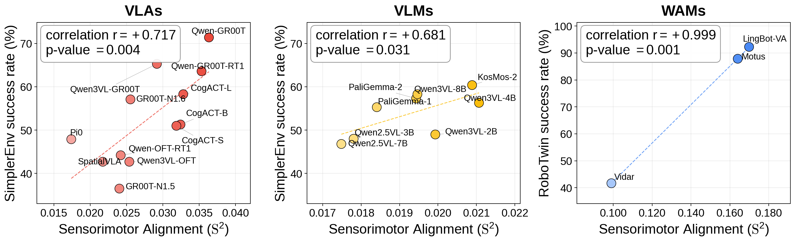
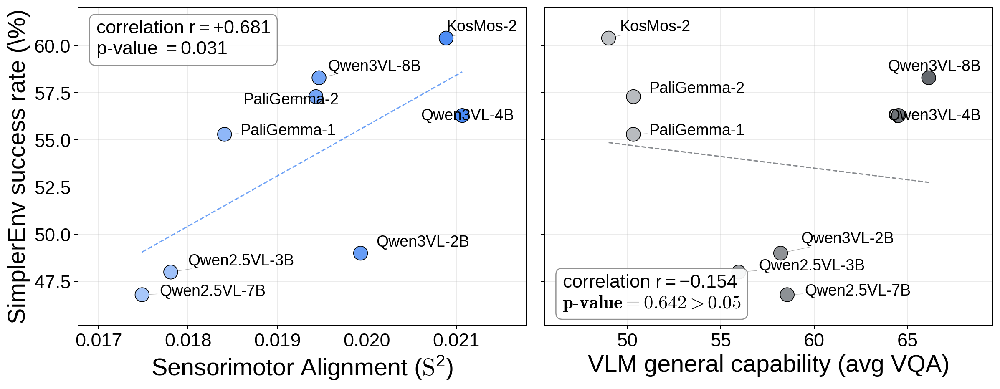
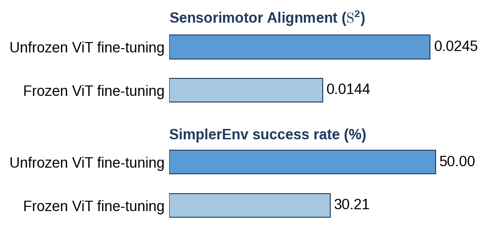

# Does the Platonic Hypothesis Extend to Robotics?

*Images, language, and motion describe the same physical world. Do capable robot models learn representations that reflect that connection?*

*Left: a robot reaching for a mug gives us two views of one physical interaction, a sensory observation and an executed motion. Sensorimotor Alignment, S², measures whether similar observations in a model's representation correspond to similar demonstrated motions. Right: each point is one VLA. Higher alignment accompanies higher task success in SimplerEnv, a robot simulation benchmark. The correlation across these twelve models is 0.717.*

A photograph of a mug and a sentence about that mug look nothing alike as inputs. Yet both describe the same world. Could models trained on images and language learn some of the same relationships?

The **Platonic Representation Hypothesis**, or PRH, proposes that they do. As models learn from more data and solve more tasks, their representations tend toward a shared statistical account of the world. Different kinds of observations reveal different parts of that world, but the structure they share can be learned. Huh and colleagues develop this idea on the [PRH project page](https://phillipi.github.io/prh/).

Here, “shared” means agreement about which examples are similar. Imagine a vision model placing pictures of mugs and cups near one another, with cabinets farther away. A language model could organize the corresponding words similarly. Their feature vectors can differ while preserving those relationships.

The [original study](https://arxiv.org/abs/2405.07987) reports increasing agreement across vision and language representations as models get larger. The broader convergence claim remains a hypothesis. For robotics, it raises a further question: **does motion reveal shared structure too?**

## What would this look like in robotics?

In Figure 1, the robot's image and the instruction “reach for the mug” describe the scene and the task. The gripper's path, orientation, and opening describe how the robot interacts with that scene. The same physical arrangement shapes both what the camera sees and how the robot can reach.

Consider two demonstrations with the mug in the same position relative to the robot. The mugs have different colors, but the gripper follows a similar path. A representation useful for that reach should retain what the two observations have in common. Now move the mug to the other side of the workspace. The instruction stays the same, but the required motion changes. The representation needs to preserve that difference too.

This gives us a question we can test. **Do more successful robot models group observations in a way that better agrees with the demonstrated motions?** We call that agreement Sensorimotor Alignment.

The comparison uses a model's sensory features and recorded physical trajectories. The trajectories provide a reference for what happened in each demonstration. They need no learned motion encoder, and a task can still admit other valid ways to move.

The example below shows how we look for agreement. For one recorded episode, we retrieve its nearest neighbors, meaning the other episodes judged most similar. The top row uses similarity of future gripper trajectories. The bottom row uses similarity of the model's observation features.

*The blue and red endpoints show the start and end of each displayed trajectory. Green checks mark sensory neighbors that also belong to the trajectory-neighbor set. These examples illustrate the comparison; the score combines measurements over the reference collection.*

Some sensory neighbors share the demonstrated motion. Others share the scene or task description while the gripper moves differently. Our question is whether models with more agreement also achieve higher policy success. Across the models we test, that is generally what we find.

## Turning the idea into a score

Start with recorded robot demonstrations. For the VLM and VLA measurements, each example contains an image, its task instruction, and the gripper trajectory that follows. This collection is the **reference dataset**, reused for every candidate model.

The model receives the image and instruction at the selected moment. Its feature vector tells us which other observations it places nearby. Separately, we compare the demonstrated trajectories using the gripper's position, orientation, and opening. These comparisons give us two sets of neighbors for the same episodes.

Agreement between the two sets contributes to a higher score. We combine these comparisons using an alignment measure adapted from the PRH work. It uses feature similarities as well as neighborhood agreement, so counting shared neighbors is an illustration rather than the full formula. This gives the Sensorimotor Alignment score, **S²**.

**The future motion is a reference for scoring; the model does not receive it as input.** Computing S² requires feature extraction on the recorded observations. It requires no new policy training or rollouts, and we can score a pretrained VLM even before it has an action head.

A score belongs to a model representation on a particular reference dataset. Changing the dataset, feature layer, or length of the trajectory can change its scale. S² is useful for comparing candidates under the same setup; it is not a success probability.

How we compare features and trajectories

We use cosine similarity for the observation features and poses relative to the robot's base for the trajectories. Dynamic time warping aligns corresponding parts of two paths, allowing similar movements performed at different speeds to match. Orientation distance uses the angle between rotations.

The alignment measure is Centered Kernel Nearest-Neighbor Alignment, or CKNNA. It combines feature similarities, centering, normalization, and local neighborhoods, with ten neighbors per episode by default. The trajectory horizon is the number of recorded steps included after the selected observation. Once the trajectory neighbors have been computed, they can be reused across candidate models.

## Do more capable policies align more closely?

To test whether S² is useful, we need an independent measure of capability. We compare each model's offline alignment score with its task success rate from closed-loop evaluation, where the policy controls the robot through a complete attempt. The rollouts establish whether the score tracks useful behavior; they are not an input to the score.

For twelve trained VLAs, we measure alignment on DROID, a collection of real robot demonstrations. We compare it with success in SimplerEnv. Each dot in the left panel below is one policy, with its alignment on the horizontal axis and success rate on the vertical axis.

**More successful VLAs tend to have higher alignment**, with a Pearson correlation of **0.717**. This is consistent with the proposed connection between sensory representations and physical behavior. The scatter shows that alignment leaves part of the variation in success unexplained.

*Left: twelve trained VLAs. Middle: eight pretrained VLMs, scored before robot fine-tuning and compared with their later policy success. Right: three video-based world-action models. Each panel is a separate comparison. The VLA and VLM panels use DROID trajectories of seven and three recorded steps, respectively, and SimplerEnv success. The world-action models use fifteen-step ALOHA trajectories, Block 7 features, and RoboTwin success. Compare alignment values within each panel. The displayed p-values are one-tailed.*

The right panel extends the test to LingBot-VA, Motus, and Vidar. These world-action models decode actions from a video-generation backbone. We score them using ALOHA demonstrations of two-arm manipulation and compare their scores with success on RoboTwin, a simulation benchmark for bimanual tasks.

Alignment recovers the success ordering of these three policies. The video-quality measures we examined, SSIM, PSNR, and FID, do not recover that ordering. Features that agree with demonstrated motion appear more informative here than the visual quality of the predicted video. With only three models, this result is an encouraging example rather than a reliable estimate of how well the score will rank a larger collection.

The middle panel asks a different question. Can this relationship help us choose a backbone before we train a robot policy?

## A signal before robot fine-tuning

We use eight pretrained VLMs from the [VLM4VLA study](https://arxiv.org/abs/2601.03309), which turned them into robot policies under a standardized fine-tuning recipe. We measure alignment on the backbones before that robot fine-tuning, using a fixed set of 6,000 DROID demonstrations.

The plot compares two ways to assess those backbones. The left uses alignment; the right uses an aggregate visual question answering score, or VQA score. Both panels show the same eventual policy success rates.

*Alignment uses the pretrained VLM's joint image-and-text output features and the next three recorded steps of each trajectory. The VQA aggregate is the one used in the VLM4VLA comparison, adjusted for differences in benchmark coverage across models. The displayed p-values are one-tailed.*

Alignment correlates with downstream success at **0.681**. The VQA aggregate has a correlation of **−0.154**. In this comparison, the motion-based measurement provides information about later control performance that the general perception score misses.

This is the practical value of the idea. Before spending compute on robot fine-tuning, we can check whether a backbone already groups observations in a way that follows demonstrated motion.

It helps prioritize candidates, with room for mistakes. Qwen3-VL-2B has relatively high alignment but lower policy success than several nearby models. An action head and its training still have to turn the features into reliable behavior. And although the reference contains thousands of demonstrations, the comparison contains **eight models**.

## The reference data matters

If observations and motions reveal a common physical structure, which recorded motions should we use as the reference?

For the twelve VLAs, the positive relationship with success appears with both DROID and BridgeDataV2, another collection of robot demonstrations. They use different single-arm robots, a Franka Panda and a WidowX. We compute alignment separately within each collection, so this result requires no matching of individual trajectories across the two robots.

The two-arm policies expose a limit. ALOHA demonstrations recover their success ordering on RoboTwin, while single-arm DROID demonstrations lose the relationship. A reference that omits coordinated two-arm behavior misses something relevant to those policies.

**Choose reference data that covers the physical behavior you want to assess.** These experiments support that choice; they do not establish that all datasets with the same number of arms are interchangeable.

How sensitive is the result to measurement settings?

On DROID, the VLA correlation stays positive across trajectory horizons from one to 220 steps, ranging from about 0.61 to 0.72 for joint output features. A separate neighborhood-size sweep at the seven-step horizon also retains a positive correlation.

The horizon sweep keeps the episodes and observation times fixed. Only the trajectory length changes, avoiding a shift in which tasks or stages of an episode enter the measurement. Allowing trajectories to align in time changes the absolute scores, especially for longer windows, but barely changes their correlation with success.

## What changes when we train a VLA?

The comparisons so far ask whether alignment tracks differences across models. We can also ask whether it helps explain a particular training decision.

Consider freezing the vision encoder. This reduces training cost, but also limits how the visual features can adapt to robot control. We compare two Qwen2.5-VL-3B policies trained under matched settings on BridgeDataV2. One updates the vision encoder; the other freezes it.

*Both runs use an FCDecoder action head and share the training setup apart from whether the vision encoder is updated. Alignment is measured on DROID at a seven-step horizon. Success is measured in SimplerEnv.*

Freezing lowers alignment by about **41%** and success from **50.00% to 30.21%**, a decrease of about twenty percentage points. The alignment decrease persists across all ten tested trajectory lengths.

Allowing the vision encoder to adapt improves how the representation groups observations relative to demonstrated motion, alongside improving control. This makes alignment useful for investigating what training changes. It does not isolate alignment as the cause of the success gain, since unfreezing changes many properties of the model at once.

Does the signal come from vision or language?

At a three-step horizon, the raw VLMs' joint image-and-text score has a stronger relationship with later success than either modality-specific score. For trained VLAs, the vision-only and joint scores have almost the same correlation, about 0.69 and 0.70. The text-only correlation is about 0.24 and is not statistically significant under the reported test.

This locates much of the predictive signal in the evaluated VLAs' visual representations. It does not establish that language is unnecessary. Testing instruction following requires changing the instruction while holding the scene fixed and measuring the resulting behavior.

## Useful features can appear early

Once we can measure agreement with physical motion, we can look for where it appears inside a model. Video-based policies make this especially interesting because their backbones repeatedly refine a noisy video prediction. Does the representation become more useful for control as that prediction becomes clearer?

In the three world-action models we test, alignment is already substantial at the earliest measured denoising point and changes relatively little afterward. Across network depth, an intermediate block has the highest alignment averaged over the sampled denoising points. Useful motion-related structure can therefore appear before the model finishes refining its video prediction.

That motivates examining earlier features when designing an action decoder. These measurements identify a possible source of useful features; deciding whether an earlier readout improves a policy still requires training and evaluating it.

Layer and denoising results

Network depth and denoising time are different. A later block processes features further within one forward pass; a later denoising point follows more repeated passes. We sample Blocks 0, 7, 14, 21, and 29 of the models' thirty-block backbones. Averaged over five denoising points, Block 14 has the highest alignment in all three models. It is the best of the sampled blocks under this measurement.

For final-layer-normalized features, the earliest and final denoising measurements are:

| Model | Earliest measured point | End of schedule |
| --- | ---: | ---: |
| Motus | 0.425 | 0.402 |
| LingBot-VA | 0.425 | 0.451 |
| Vidar | 0.487 | 0.476 |

*These alignment scores use 50 RoboTwin tasks with ten episodes per task. This is a different reference set and feature position from the ALOHA comparison in Figure 3. Intermediate denoising points follow the same broad pattern.*

Even at an early denoising point, the features have been computed by a model conditioned on the observation. They can carry motion-related structure while the video prediction is still noisy. This is consistent with prior work such as [Fast-WAM](https://arxiv.org/abs/2603.16666), which finds that much of video denoising can be skipped during action inference.

## What does this tell us about the hypothesis?

We find a robotics counterpart to the pattern that motivates the Platonic hypothesis. Across the tested VLAs and pretrained VLM backbones, **greater agreement between sensory representations and demonstrated motion accompanies better control**. A smaller comparison of video-based policies points in the same direction.

This supports a connection between capability and shared physical structure. It does not establish that robot models converge to one representation as they scale, or that increasing alignment by itself causes better behavior.

The connection is useful today as an offline measurement. To compare candidates, choose demonstrations that cover the relevant motions and keep the observations, feature readout, trajectory length, and neighborhood size fixed. Use the scores to prioritize training runs or investigate changes inside a model, then evaluate the resulting policies in closed loop.

The demonstrations provide one set of valid motions, while a capable robot may use others. The score also leaves out recovery from mistakes during execution. Our main success comparisons use simulation benchmarks, so broader claims about real-world performance need further testing.

The next question is whether we can use the connection to help a robot learn. If we deliberately train sensory representations to agree more closely with physical motion, will control improve? That would turn the relationship we measure here into a test of how shared representations contribute to capability.

*Based on our research, “Sensorimotor Alignment: A Platonic Proxy for Embodied Policy Success,” by Yunfei Xie, Howard H. Qian, Shiyi Lan, Kaiyu Hang, and Chen Wei.*
