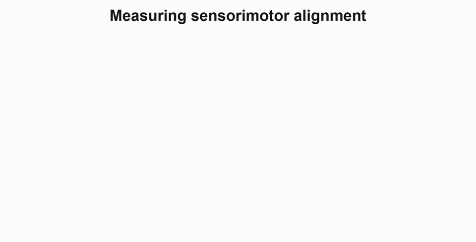
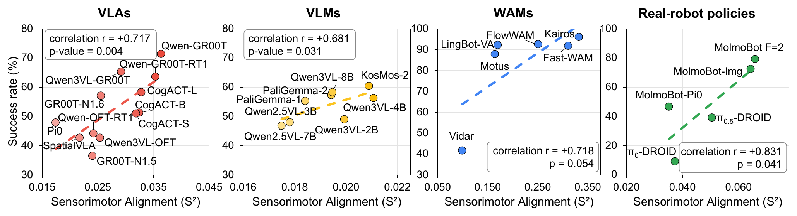
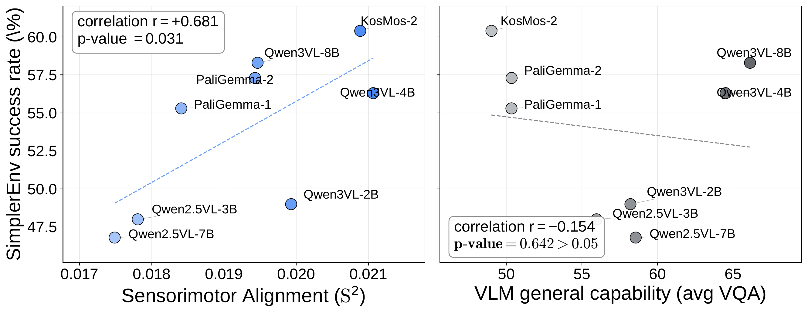
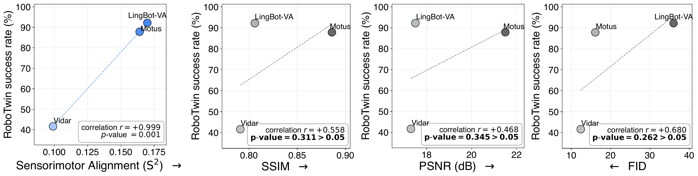
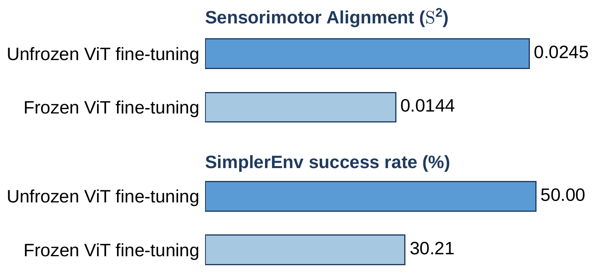
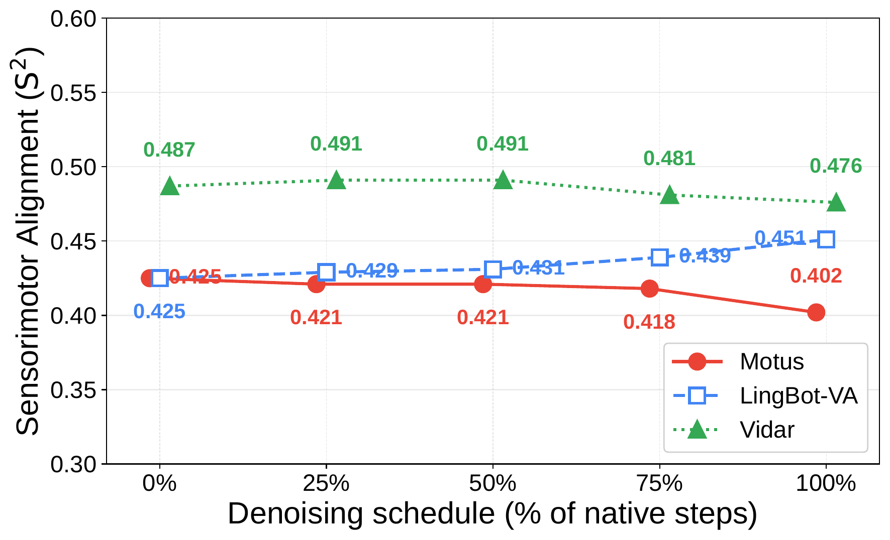
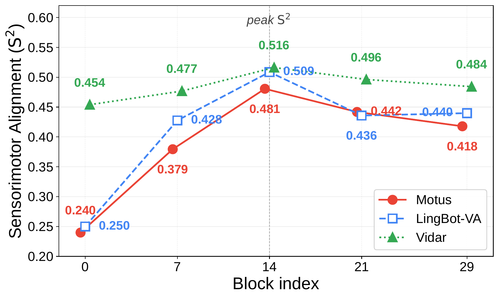

<!--
Conventions build.py relies on:
- An optional italic paragraph right after the H1 becomes the subtitle (dek).
- An image paragraph followed by an italic paragraph becomes a numbered figure with that caption; Figure 1 is pulled out as the opening figure.
- Footnotes ([^key]) become margin sidenotes. Write each definition as: [Title](link) (Author et al, Year).
- A table followed by an italic paragraph gets that paragraph as its caption.
- H2 and H3 headings appear in the contents list on the left.
-->

# Sensorimotor Alignment: A Platonic Proxy for Embodied Policy Success


*Left: a robot reaching for a mug gives us two views of one physical interaction, a sensory observation and an executed motion. Sensorimotor Alignment, S², measures whether similar observations in a model's representation correspond to similar demonstrated motions. Right: each point is one VLA. Higher alignment accompanies higher task success in SimplerEnv, a robot simulation benchmark. The correlation across these twelve models is 0.717.*

The Platonic Representation Hypothesis (PRH)[^prh] argues that as vision and language models scale, their representation spaces converge toward a shared statistical model of reality. The idea is that images and text are different projections of the same underlying world. As models recover that world more faithfully, they begin to agree on which inputs are similar. For example, if a vision model places two images close together, a language model tends to place their captions close together too.

In this work, we bring PRH to robotics and ask: can physical actions be viewed as another projection of that world, such that more capable embodied models better align their vision and language representations with the structure of motion trajectories?

Our evidence suggests the answer is yes. To test this, we measure how well an embodied model's representation of its sensory input, a visual observation paired with a language instruction, aligns with the trajectory the robot then executes. Put simply, if two situations look alike to the model, they should also call for similar motions. We call this measure sensorimotor alignment (S²).

Our first finding is that S² is positively related to downstream robot task success. We test a range of Vision-Language-Action models (VLAs) and World Action Models (WAMs), both in simulation and on real robots. In every setting, models with higher S² achieve higher task success rates. This pattern suggests that PRH also holds in robotics: a more capable embodied model is one whose vision and language representations better reflect the structure of physical motion.

S² also explains, at the representation level, several behaviors that prior work has only observed empirically. For example, VLAs often ignore the language instruction and act mainly on what they see. We find that their task success tracks the S² of their vision features, not their text features.

In practice, S² can serve as a low-cost offline proxy for identifying which models are likely to achieve higher task success before closed-loop evaluation. For instance, it can identify promising VLM backbones even before costly VLA fine-tuning.

## Measuring sensorimotor alignment

<div class="alignment-animations">
  
  
</div>

Camera features and robot trajectories live in different spaces, so we cannot compare them directly. Following PRH,[^prh] we instead compare their *similarity structures*: does each representation judge the same pairs of episodes to be alike? Each side gives us a kernel $K$, a matrix of pairwise similarities over the same episodes, and S² scores how well the two kernels agree.

**S² operates on fixed offline episodes.** We compute S² on a fixed offline dataset $\mathcal{D} = \{e_i\}_{i=1}^N$, such as DROID.[^droid] Each episode $e_i = (\mathbf{x}_i, \boldsymbol{\tau}_i)$ pairs a sensory input $\mathbf{x}_i$, made up of a camera image and a language instruction, with the trajectory $\boldsymbol{\tau}_i$ that a human teleoperator then executed. Every model is scored against the same recorded trajectories, so no closed-loop rollouts are needed.

**The sensory kernel captures sensory feature similarity.** We feed $\mathbf{x}_i$ to the model, extract a feature vector $\mathbf{z}_i$, and compare episodes by cosine similarity, $K^{\mathrm{sensory}}_{ij} = \cos(\mathbf{z}_i, \mathbf{z}_j)$. For video datasets, we use only the first frame of each episode, matching standard VLA inputs. Because this works for any architecture and layer, we can compare vision features, text features, or features taken at different depths.

**The motor kernel captures physical trajectory similarity.** Each trajectory records the end-effector position, orientation, and gripper state, expressed in the robot base frame. The same task can be performed faster or slower, so we compare trajectories with dynamic time warping (DTW),[^dtw] which aligns their timing before measuring distance, $K^{\mathrm{motor}}_{ij} = \mathrm{DTW}(\boldsymbol{\tau}_i, \boldsymbol{\tau}_j)$. The local DTW cost uses geodesic distance on SO(3) for rotations and native coordinates for positions and gripper state.

**S² scores the structural agreement.** To compare the two kernels, we look at neighborhoods. For each episode, we retrieve its nearest neighbors under each kernel, ten in our experiments. If the model organizes episodes by the motion they require, the two neighbor sets should largely overlap. The figure below shows this comparison for a single query episode.


*Sensorimotor Alignment compares neighbors in sensory and motor representation space. For a query episode, we retrieve its motor neighbors by trajectory similarity and its sensory neighbors by vision-text representation similarity. Green checks denote sensory neighbors that agree with the motor-neighbor set, while red crosses show visually plausible but motor-inconsistent neighbors. Higher agreement yields a higher S² score, indicating that the model's sensory representation reflects the trajectory similarity needed for control.*

Of the four sensory neighbors shown, two also appear among the query's motor neighbors (green checks). The other two look plausible but call for different motions (red crosses). One of them even shares the query's instruction, "place cans into cabinet", so a model that groups episodes by what they look or sound like, rather than by the motion they require, would place it nearby and lose agreement.

S² aggregates this agreement over every query episode. We use Centered Kernel Nearest-Neighbor Alignment (CKNNA) from PRH,[^prh] which measures how strongly the two kernels co-vary within these shared neighborhoods:

$$\mathrm{S}^2 = \mathrm{CKNNA}\left(K^{\mathrm{sensory}}, K^{\mathrm{motor}}\right)$$

A high S² means the model places episodes close together when they call for similar motions, not merely when they look or sound alike.


## S² Relates to Robot Task Success Rate

Action is a harder test case for PRH[^prh] than vision or language: it is a physical trajectory, not another passive observation. We test a concrete prediction: a model's S² should positively relate to its downstream robot task success. If it does, S² can serve as a low-cost offline proxy for identifying which models are likely to achieve higher task success before closed-loop evaluation.

Below, we show this relation across three model families and real-robot policies, and compare S² with VQA and video-quality metrics.

### S² Relates to Task Success Across Model Families

We ask whether stronger alignment between sensory and motor similarity structures accompanies higher task success. In the figure below, we test this across three model families and on policies evaluated on real robots. For each model, we compute S² from its sensory features on a reference dataset (x-axis) and compare it with the model's downstream manipulation success rate (y-axis). Appendix A.4 of our paper lists the evaluated VLAs, VLMs, WAMs, and real-robot policies, along with their evaluation protocols and conditions.



*S² correlates with task success across diverse model families and both simulated and real-world task evaluations. From left to right, each panel plots offline S² (x-axis) against downstream task success rate (y-axis) for finetuned VLAs, raw VLMs, WAMs, and real-robot policies. These correlations support S² as a paradigm-agnostic metric.*

**Vision-language-action models (VLAs).** We test 12 VLAs against their SimplerEnv[^simplerenv] success rates. The correlation r = +0.717 is strong. This correlation supports our premise that S² measures how well a representation supports control.

**Vision-language models (VLMs).** We ask whether S² computed on a raw VLM, before any robot fine-tuning, relates to the task success of the VLA built from it. We compute S² for 8 raw VLM backbones from VLM4VLA[^vlm4vla] on the DROID dataset[^droid] and compare it with the SimplerEnv[^simplerenv] success rate of the VLAs that VLM4VLA fine-tunes from them. We find a strong correlation with downstream VLA success rate: r = +0.681. This result demonstrates the practical utility of S²: models with stronger sensorimotor alignment before fine-tuning tend to achieve higher downstream task success, so S² can identify promising VLM backbones even before costly VLA fine-tuning.

**World action models (WAMs).** Finally, we ask whether the relation extends to WAMs, which build on video generators rather than VLMs. We compute S² for 6 WAMs on the bimanual ALOHA dataset[^aloha] and compare it with their success rates on RoboTwin 2.0[^robotwin]. For WAMs, the sensory representation is the video-generator latent used for action decoding, and all 6 models share the same ALOHA trajectories and S² settings. Across these 6 models, S² shows a strong correlation with task success, r = +0.718.

**Real-robot policies.** We test whether the relation between S² and task success in simulation extends to real robots. Because real-world success rates depend on the task set, robot, cameras, and protocol, we use the physical-robot success rates that MolmoB0T[^molmobot] reports for 5 policies on the same 40 tasks, and compute S² for their public checkpoints on the same 6,000-episode DROID subset. Across these 5 policies, S² shows a strong correlation with real-robot task success, r = +0.831.

We further validate that S² is related to downstream task success for frozen vision backbones under low-data behavior cloning and visual-reward learning (Appendix B.1 of our paper).

### S² Relates to Task Success More Closely Than Alternative Metrics

Prior work asks whether offline evaluation scores predict downstream control performance. VLM4VLA[^vlm4vla] examines the correlation between VQA benchmark scores and the performance of the resulting VLA policies, finding weak or even negative correlations. For video models, Tian et al.[^tian] compare the quality of WAM-generated video with downstream control performance and find that the agreement is inconsistent across tasks. A common limitation is that these metrics measure language understanding or pixel-level video quality, neither of which is grounded in the physical actions the robot must execute. S² addresses this gap by directly linking perception to action. As we show below, S² correlates more strongly with task success rate than any VQA or video-quality metric we evaluate.

**S² correlates with VLA success rate where VQA scores do not.** We compare S² with aggregate VQA scores as offline proxies of downstream VLA success rate, using the same 8 raw VLM backbones and evaluation setting as in the VLM comparison above. We find that VQA scores show virtually no correlation with VLA success rate at r = −0.154 (figure below, right), whereas S² correlates strongly at r = +0.681 (figure below, left). S² thus tracks VLA success rate where VQA benchmarks do not.



*Raw VLM S² correlates with downstream VLA success rate. Across 8 models,[^vlm4vla] raw VLM VQA scores (right) show virtually no correlation with finetuned SimplerEnv policy success rate. S² (left) correlates strongly with policy success rate, offering a cheap guide to model choice. The left panel repeats the raw-VLM result from the figure above for comparison.*

**S² correlates with WAM success rate more closely than video-quality metrics.** We compare S² with standard video-quality metrics (FID[^fid], SSIM[^ssim], and PSNR[^psnr]) on 3 of the WAMs, Motus[^motus], LingBot-VA[^lingbot], and Vidar[^vidar], evaluated on RoboTwin. We find that video-quality metrics show no significant correlations with task success: SSIM reaches only r = +0.558 and PSNR only r = +0.468 (figure below). FID even correlates in the wrong direction. Because lower FID indicates higher video quality, a useful FID proxy would correlate negatively with task success; instead, we find r = +0.680. In contrast, S² computed on ALOHA episodes correlates far more strongly at r = +0.999 and is the only metric that correctly recovers the success-rate ordering. Pixel-level prediction quality thus shows little relation to the task success that S² captures.



*S² correlates with WAM success rate where perceptual metrics do not. For 3 WAM policies evaluated on RoboTwin, standard video-quality metrics (SSIM, PSNR, FID) show no significant correlations with task success. In contrast, only S² computed on ALOHA episodes correctly recovers the success-rate ordering. Only 3 of the 6 WAMs are compared, because the others do not generate future video during control evaluation.*

## Representation-Level Explanations with S²

Prior work reports several phenomena in VLAs and WAMs based only on closed-loop results. Because S² relates to task success, as shown above, we use it to provide a representation-level explanation for each of these phenomena, as summarized below:

- **[Modality dominance](#what-carries-the-correlation-vision-text-or-both)**: prior work observes that VLAs often struggle with instruction grounding[^liberoplus][^liberocf][^igar]. We explain that after VLA fine-tuning, task success is associated with vision-feature S² but not text-feature S², indicating that fine-tuned VLAs rely mainly on visual rather than language representations for control.
- **[Frozen encoders](#freezing-vision-encoders-limits-s²-gain)**: prior work observes that freezing the vision encoder during VLA fine-tuning degrades downstream task performance[^vlm4vla]. We explain that freezing also prevents the S² gain from end-to-end fine-tuning, indicating that fine-tuning improves control by aligning the visual representation more closely with motor structure.
- **[Iterative denoising](#features-at-early-denoising-steps-already-carry-strong-sensorimotor-alignment)**: prior work observes that WAMs can skip iterative video denoising at test time, decoding actions without generating future video, with little loss in task success[^fastwam]. We explain that the S² of WAM features is already high at the earliest denoising step and changes little afterwards. Early-step features are therefore already sufficiently aligned with robot trajectories to generate actions.
- **[Mid-depth blocks](#mid-depth-blocks-carry-the-strongest-sensorimotor-alignment)**: prior work observes that mid-depth blocks of video diffusion transformers are especially important for semantic reasoning[^demystifying]. We explain that the same mid-depth blocks carry the strongest S², indicating that the layers that reason about video semantics are also the layers most aligned with robot actions.

### What Carries the Correlation: Vision, Text, or Both?

Prior work observes that VLAs often struggle with instruction grounding, acting on what the scene suggests rather than on what the instruction asks[^liberoplus][^liberocf][^igar]. We ask which modality carries the correlation with task success: vision, text, or both. In the figure below, we compute S² separately for each modality. We take the VLM output tokens read by the action head and form *vision features* from the image tokens, *text features* from the instruction tokens, and *joint vision-text features* from all tokens. The full per-model S² values across all feature positions are reported in Appendix D.1 of our paper.


*Fine-tuned VLAs rely mainly on visual rather than language representations for control. We correlate S² computed from vision features, text features, and joint vision-text features with SimplerEnv success rate. **Top:** For fine-tuned VLAs, S² from vision features and from joint features yields similarly strong correlations, while S² from text features is weak, indicating that fine-tuned VLAs rely mainly on visual rather than language representations for control. **Bottom:** For raw VLMs before any robot fine-tuning, neither vision-only nor text-only S² reaches significance, but the joint vision-text representation still predicts downstream task success.*

**Fine-tuned VLAs rely mainly on visual rather than language representations for control.** At horizon *h* = 3, we find that S² from vision features correlates with the SimplerEnv success rate of the 12 fine-tuned VLAs at r = +0.694, nearly matching joint vision-text features at r = +0.699, while S² from text features shows no significant relation at r = +0.237. Before fine-tuning, the pattern differs: in raw VLMs, S² from text features correlates at r = +0.501, more strongly than vision features at r = +0.425, and joint vision-text features correlate most strongly at r = +0.681.

We therefore infer that fine-tuned VLAs rely mainly on visual rather than language representations for control, which explains their weak instruction grounding at the representation level.

### Freezing Vision Encoders Limits S² Gain

VLM4VLA[^vlm4vla] reports that freezing the vision encoder during VLA fine-tuning severely degrades downstream robotics performance. We use S² to test whether end-to-end fine-tuning improves control by increasing sensorimotor alignment in the action-head input.

In the figure below, we compare 2 VLAs differing only in whether the vision encoder is frozen during fine-tuning. Both attach an FCDecoder action head to Qwen2.5-VL-3B[^qwen25vl] and are fine-tuned on BridgeDataV2 with the same recipe, following VLM4VLA[^vlm4vla]. For each, we compute S² from the joint vision-text features read by the action head and measure SimplerEnv success rate. Freezing the encoder reduces S² by 41% and the downstream task success rate by 40%. The S² drop holds at all 10 motion horizons, ranging from 38% to 49% (Appendix D.2 of our paper).



*Freezing the ViT vision encoder reduces both S² and the downstream task success rate. For a Qwen2.5-VL-3B VLA fine-tuned on BridgeData v2, we compare end-to-end training with a frozen vision encoder. Freezing lowers both S² from joint vision-text features (top) and SimplerEnv success rate (bottom), suggesting that freezing limits policy performance through the representation itself, which S² detects. Motion horizon h = 7.*

We infer that end-to-end fine-tuning improves control by aligning visual representations more closely with robot trajectories, which explains why freezing the vision encoder lowers task success.

### Features at Early Denoising Steps Already Carry Strong Sensorimotor Alignment

Most WAMs generate future video through iterative denoising and decode actions from the resulting latents. Fast-WAM[^fastwam] shows that WAMs can skip iterative video denoising at test time, decoding actions without generating future video, with little loss in task success. We use S² to test whether features at early denoising steps are already aligned with robot trajectories.

In the figure below, we track S² along the denoising schedule of 3 WAMs[^motus][^lingbot][^vidar] on RoboTwin[^robotwin]. For each model, we extract latent features and compute S² at 5 points in its native schedule, from 0% to 100%. S² is already high at the earliest point and remains nearly flat, varying by at most 6% from its initial value across all 3 models. We therefore infer that early-step features are already sufficiently aligned with robot trajectories to generate actions. Because S² correlates with WAM success rate, as shown above, this result explains why skipping iterative video denoising barely lowers task success.



*S² is nearly flat across the denoising schedule, suggesting that early-step features are already sufficiently aligned with robot trajectories to generate actions.*

### Mid-Depth Blocks Carry the Strongest Sensorimotor Alignment

Prior analysis of Chain-of-Steps[^demystifying] shows that mid-depth layers in Video Diffusion Transformers are especially important for semantic reasoning over objects and interactions. We test whether the layers with the highest S² also lie within this semantic window.

In the figure below, we compute S² at different depths of 3 WAMs[^motus][^lingbot][^vidar] on RoboTwin. All 3 share a 30-block video backbone, and we extract features from Blocks 0, 7, 14, 21, and 29. Block 14 consistently yields the highest S² across all 3 models. We find that this peak falls within the mid-depth semantic window identified by Chain-of-Steps[^demystifying], and infer that the layers that reason about video semantics are also the layers most aligned with robot actions. Appendix D.3 of our paper gives the full analysis.



*S² peaks at Block 14 in all 3 WAMs, indicating that mid-depth layers carry the strongest sensorimotor alignment.*

## Citation

Please cite this work as:

```
Xie, Yunfei, Howard H. Qian, Shiyi Lan, Kaiyu Hang, and Chen Wei. "Sensorimotor Alignment: A Platonic Proxy for Embodied Policy Success." 2026.
```

Or use the BibTeX citation:

```
@misc{xie2026sensorimotor,
  title  = {Sensorimotor Alignment: A Platonic Proxy for Embodied Policy Success},
  author = {Xie, Yunfei and Qian, Howard H. and Lan, Shiyi and Hang, Kaiyu and Wei, Chen},
  year   = {2026}
}
```

[^prh]: [The Platonic Representation Hypothesis](https://arxiv.org/abs/2405.07987) (Huh et al, 2024)
[^droid]: [DROID: A Large-Scale In-the-Wild Robot Manipulation Dataset](https://arxiv.org/abs/2403.12945) (Khazatsky et al, 2024)
[^dtw]: [Dynamic Programming Algorithm Optimization for Spoken Word Recognition](https://doi.org/10.1109/TASSP.1978.1163055) (Sakoe and Chiba, 1978)
[^simplerenv]: [Evaluating Real-World Robot Manipulation Policies in Simulation](https://arxiv.org/abs/2405.05941) (Li et al, 2024)
[^vlm4vla]: [VLM4VLA: Revisiting Vision-Language-Models in Vision-Language-Action Models](https://arxiv.org/abs/2601.03309) (Zhang et al, 2026)
[^aloha]: [Learning Fine-Grained Bimanual Manipulation with Low-Cost Hardware](https://arxiv.org/abs/2304.13705) (Zhao et al, 2023)
[^robotwin]: [RoboTwin: Dual-Arm Robot Benchmark with Generative Digital Twins](https://arxiv.org/abs/2504.13059) (Mu et al, 2025)
[^molmobot]: [MolmoB0T: Large-Scale Simulation Enables Zero-Shot Manipulation](https://arxiv.org/abs/2603.16861) (Deshpande et al, 2026)
[^tian]: [A Control-Centric Benchmark for Video Prediction](https://arxiv.org/abs/2304.13723) (Tian et al, 2023)
[^fid]: [GANs Trained by a Two Time-Scale Update Rule Converge to a Local Nash Equilibrium](https://arxiv.org/abs/1706.08500) (Heusel et al, 2017)
[^ssim]: [Image Quality Assessment: From Error Visibility to Structural Similarity](https://doi.org/10.1109/TIP.2003.819861) (Wang et al, 2004)
[^psnr]: [Image Quality Metrics: PSNR vs. SSIM](https://doi.org/10.1109/ICPR.2010.579) (Horé and Ziou, 2010)
[^liberoplus]: [LIBERO-Plus: A Progressive Robustness Benchmark for Visual-Language-Action Models](https://arxiv.org/abs/2510.13626) (Fei et al, 2026)
[^liberocf]: [When Vision Overrides Language: Evaluating and Mitigating Counterfactual Failures in VLAs](https://arxiv.org/abs/2602.17659) (Fang et al, 2026)
[^igar]: [Restoring Linguistic Grounding in VLA Models via Train-Free Attention Recalibration](https://arxiv.org/abs/2603.06001) (Zhang et al, 2026)
[^fastwam]: [Fast-WAM: Do World Action Models Need Test-time Future Imagination?](https://arxiv.org/abs/2603.16666) (Yuan et al, 2026)
[^demystifying]: [Demystifying Video Reasoning](https://arxiv.org/abs/2603.16870) (Wang et al, 2026)
[^qwen25vl]: [Qwen2.5-VL Technical Report](https://arxiv.org/abs/2502.13923) (Bai et al, 2025)
[^motus]: [Motus: A Unified Latent Action World Model](https://arxiv.org/abs/2512.13030) (Bi et al, 2026)
[^lingbot]: [Causal World Modeling for Robot Control](https://arxiv.org/abs/2601.21998) (Li et al, 2026)
[^vidar]: [Vidar: Embodied Video Diffusion Model for Generalist Manipulation](https://arxiv.org/abs/2507.12898) (Feng et al, 2025)
